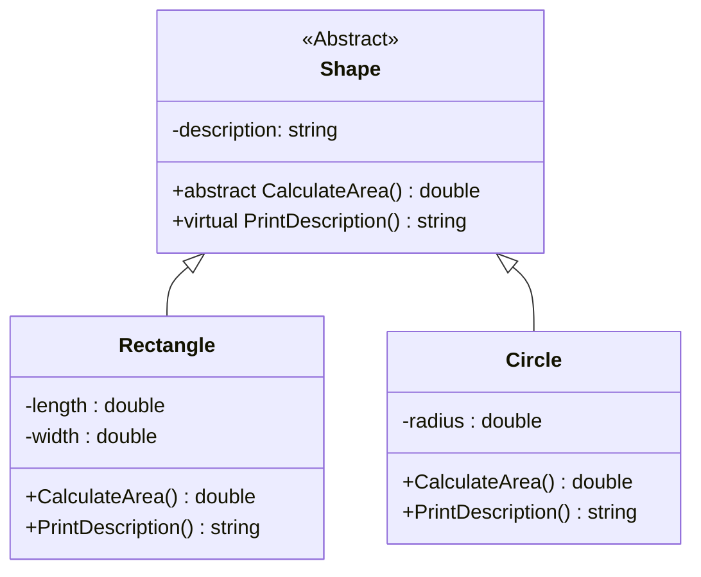
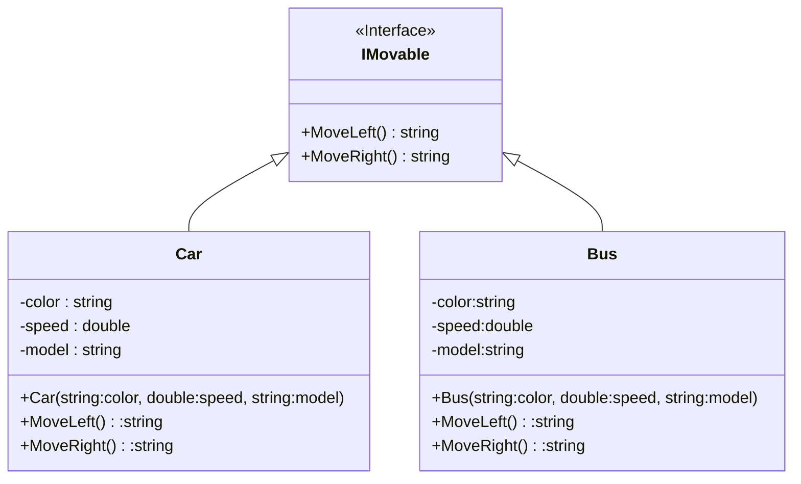
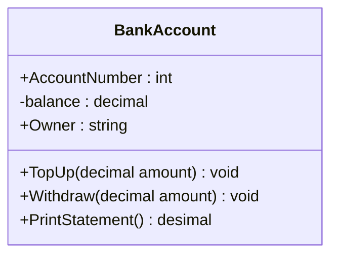
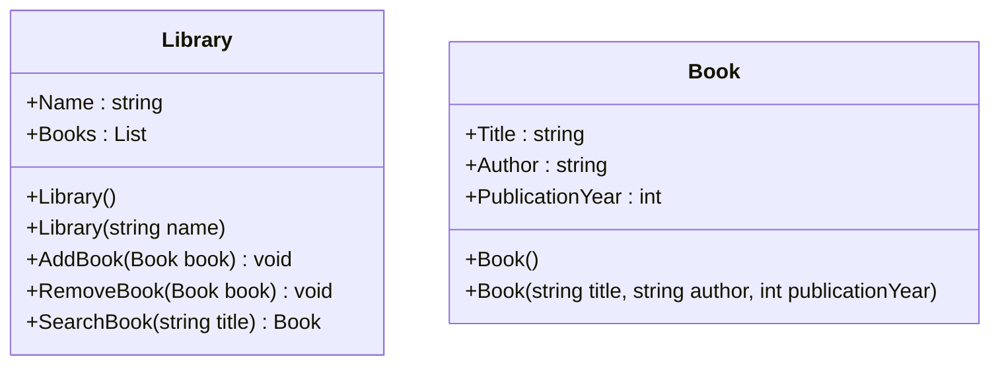

### Task 1
Create a abstract class called `Shape` with the following properties and methods:

- Abstract method: `CalculateArea()` - Calculate and return the area of the shape.
- Virtual method: `PrintDescription()` - Print a description of the shape.

Implement two child classes, `Rectangle` and `Circle`, which inherit from the `Shape` class.                                             
Override the `CalculateArea()` and `PrintDescription()` methods in each child class to provide their specific implementations. 

---

Создайте класс под названием `Shape` со следующими свойствами и методами:

- Абстрактный метод: `CalculateArea()` — вычисляет и возвращает площадь фигуры.
- Виртуальный метод: `PrintDescription()` — распечатывает описание фигуры.

Реализуйте два дочерних класса: `Rectangle` и `Circle`, которые наследуются от класса `Shape`.
Переопределите методы `CalculateArea()` и `PrintDescription()` в каждом дочернем классе, чтобы обеспечить их конкретную реализацию.

##
### Task 2
Create an interface called `IMovable` with the following methods:

- `MoveLeft()` - Prints a message indicating the car is moving left.
- `MoveRight()` - Prints a message indicating the car is moving right.

Implement the `IMovable` interface in a class called `Car` and provide the necessary implementations for the methods to print appropriate messages indicating the car's movement direction.   

--- 

Создайте интерфейс под названием «IMovable» с помощью следующих методов:

- `MoveLeft()` — печатает сообщение, указывающее, что машина движется влево.
- `MoveRight()` — печатает сообщение, указывающее, что машина движется вправо.

Реализуйте интерфейс `Imovable` в классе `Car` и предоставьте необходимые реализации.
для методов вывода соответствующих сообщений, указывающих направление движения автомобиля.

##
### Task 3

Create a class called `BankAccount` with the following properties, fields and methods:

Properties:
- `AccountNumber` (int) - Represents the account number.
- `Owner` (string) - Represents the account owner's name.
- `balance` (decimal) - Represents the current balance.

Methods:
- `TopUp(decimal amount)` - Deposits the specified amount into the account.
- `Withdraw(decimal amount)` - Withdraws the specified amount from the account.
- `PrintStatement()` - Prints a statement with the account details and current balance.

---

Создайте класс BankAccount со следующими свойствами и методами:

Характеристики:
- `AccountNumber` (строка) — представляет номер счета.
- `balance` (десятичный) — представляет текущий баланс.
- `Owner` (строка) — представляет имя владельца учетной записи.

Методы:
- `TopUp(decimal amount)` - Вносит указанную сумму на счет.
- `Withdraw(decimal amount)` - Выводит указанную сумму со счета.
- `PrintStatement()` — печатает выписку с данными счета и текущим балансом.

##
### Task 4
Create a class called `Library` that represents a library management system.                               
The `Library` class should have the following properties and methods:                            

Properties:
- `Name` (string) - Represents the name of the library.
- `Books` - Represents a collection (e.g., list, array) of book objects.

Methods:
- `AddBook(Book book)` - Adds a book to the library.
- `RemoveBook(Book book)` - Removes a book from the library.
- `SearchBook(string title)` - Searches for a book by title and returns the book object.

Create a separate class called `Book` with the following properties:

Properties:
- `Title` (string) - Represents the title of the book.
- `Author` (string) - Represents the author of the book.
- `PublicationYear` (int) - Represents the publication year of the book.

---

Создайте класс под названием `Library`, который представляет систему управления библиотекой.
Класс `Library` должен иметь следующие свойства и методы:

Характеристики:
- `Name` (строка) — представляет имя библиотеки.
— `Book` — представляет коллекцию (например, список, массив) объектов книги.

Методы:
- `AddBook(Book book)` - Добавляет книгу в библиотеку.
- `RemoveBook(Book book)` - Удаляет книгу из библиотеки.
- `SearchBook(string title)` — ищет книгу по названию и возвращает объект книги.

Создайте отдельный класс под названием Book со следующими свойствами:

Характеристики:
- `Title` (string) – представляет название книги.
- `Автор` (string) — представляет автора книги.
- `PublicationYear` (int) — представляет год публикации книги.

